<div align="center">

# sd-policetape

<a href="https://fivem.samueldev.shop">
  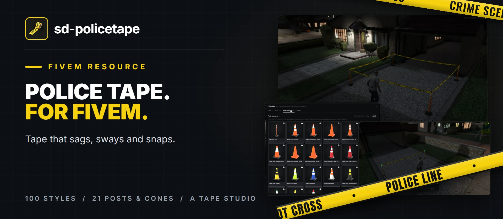
</a>

---

sd-policetape is police tape that behaves like tape. It sags with its length, sways and twists in the game's wind, bows round people's legs and a car's bonnet when they push into it, springs back when they let go, and tears, for everybody, when a vehicle drives through it too fast.

Tie it to a wall, a fence, a pole or a tree, or stand it on open ground on a delineator post or one of twenty traffic cones, each picked from a menu with its picture. Cars, kicks and runners knock the cones over, and the tape goes down with them. A hundred styles come with it, and a Tape Studio makes more in game.

Admins see every tape on the server in `/tapeadmin`, choose which styles and cones police get, and switch tearing, physics, wind and saving on and off while the server runs.

[](https://github.com/Samuels-Development/sd-policetape)
[](https://discord.gg/FzPehMQaBQ)


[**Store**](https://fivem.samueldev.shop) · [**Discord**](https://discord.gg/FzPehMQaBQ)

</div>

---

## Support Me

If you're enjoying sd-policetape and want to support my work, consider picking up a script from [Samuel's Development](https://fivem.samueldev.shop). Every purchase helps me keep building and improving resources like sd-policetape. Browse Petty Crimes, Advanced Crafting, Horde, Smash Down, and more to find something for your server.

## In game

A driveway in Mirror Park, taped off. Click any image for the full-size version.

<p align="center"><a href="docs/previews/ingame/scene.webp">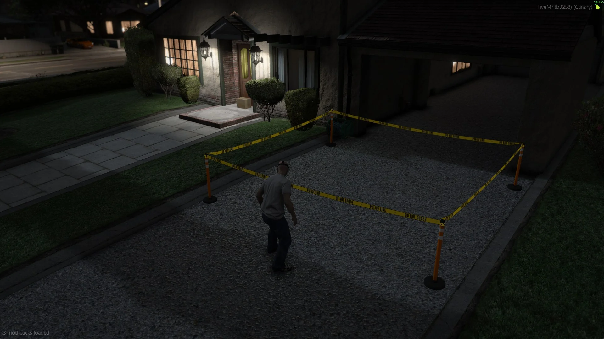</a></p>
<p align="center"><sub>Four posts and four stretches of tape, sagging with their length</sub></p>

<div align="center">
<table>
  <tr>
    <td align="center" width="50%"><a href="docs/previews/ingame/placing.webp">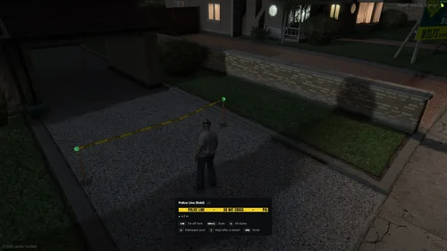</a><br /><sub><b>Placing:</b> the stretch is live while you aim, and the prompt says how long it is</sub></td>
    <td align="center" width="50%"><a href="docs/previews/ingame/holders.webp">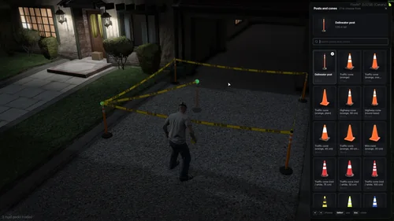</a><br /><sub><b>Posts and cones:</b> <kbd>H</kbd> while placing, a picture of each</sub></td>
  </tr>
  <tr>
    <td align="center" width="50%"><a href="docs/previews/ingame/torn.webp">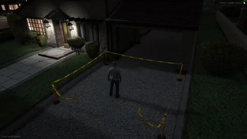</a><br /><sub><b>Torn:</b> it snaps for everybody, and the ends fall where they hang</sub></td>
    <td align="center" width="50%"><a href="docs/previews/ingame/edit.webp">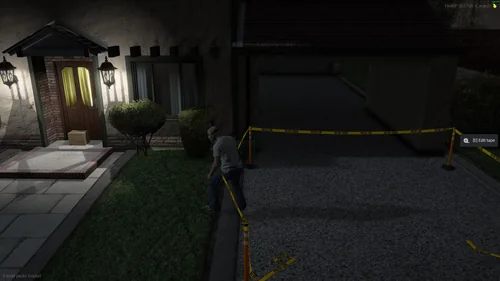</a><br /><sub><b>Pushing through:</b> it bows round the legs; <kbd>E</kbd> opens a tape to edit</sub></td>
  </tr>
</table>
</div>

## 100 styles

Every one drawn by the same code that draws the tape in the world, so what you see here is what goes up.

<p align="center"><a href="docs/previews/styles/hero.webp">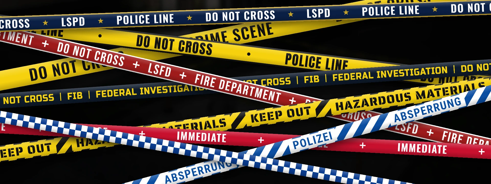</a></p>

<p align="center"><a href="docs/previews/styles/police.webp">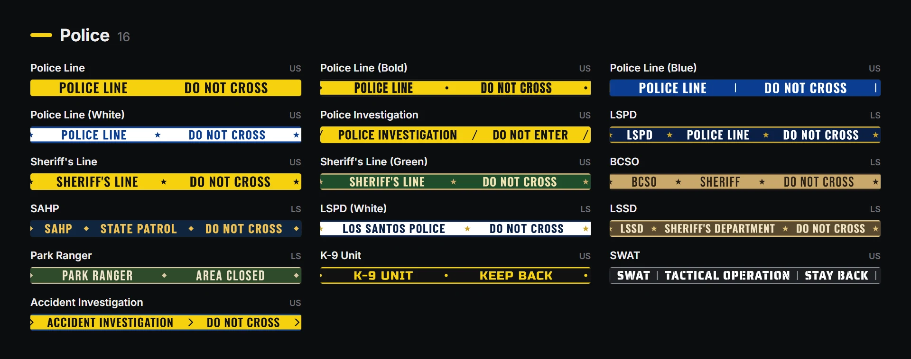</a></p>

<details>
<summary><b>Every built-in style (100)</b></summary>
<br />

<p align="center">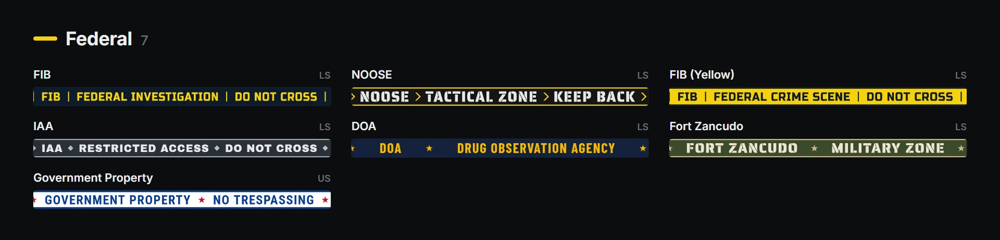</p>
<p align="center">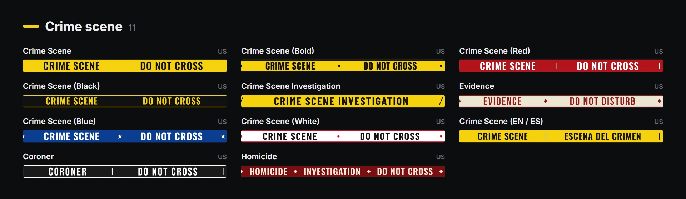</p>
<p align="center">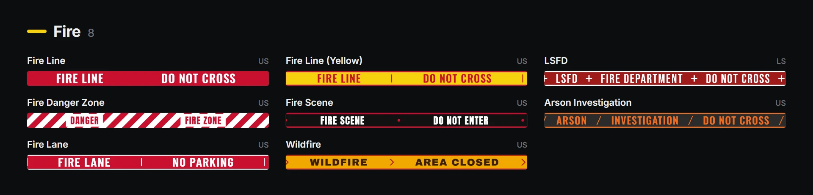</p>
<p align="center">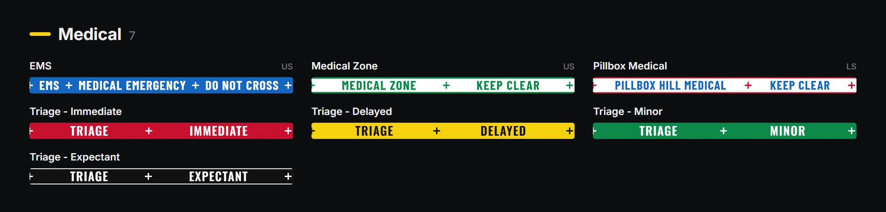</p>
<p align="center">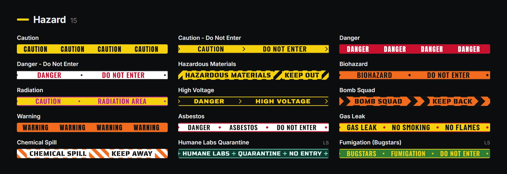</p>
<p align="center">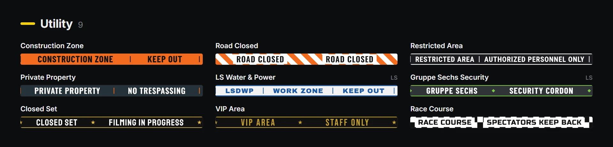</p>
<p align="center">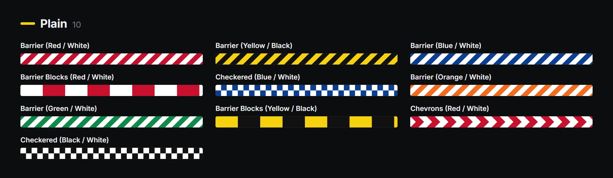</p>
<p align="center">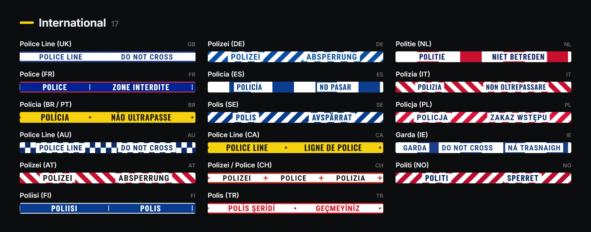</p>

</details>

<div align="center">
<table>
  <tr>
    <td align="center" width="50%"><a href="docs/previews/ingame/picker.webp">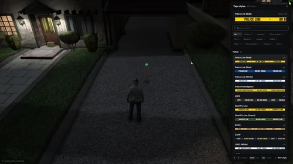</a><br /><sub><b>The style picker:</b> <kbd>G</kbd> while placing, or <code>/tapestyles</code></sub></td>
    <td align="center" width="50%"><a href="docs/previews/ingame/picker-hazard.webp">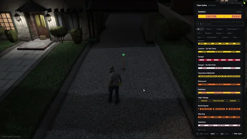</a><br /><sub><b>By category,</b> plus <b>Custom</b> and <b>Yours</b> for the Tape Studio's</sub></td>
  </tr>
</table>
</div>

## Posts and cones

What tape stands on in the open: a delineator post and twenty cones, each with its own size, base and the height the tape is tied at. Knocked over, a holder tips over the edge of its base and lies where it fell, with the tape slack or torn; anyone allowed to use tape stands it back up.

<p align="center"><a href="docs/previews/holders/all.webp">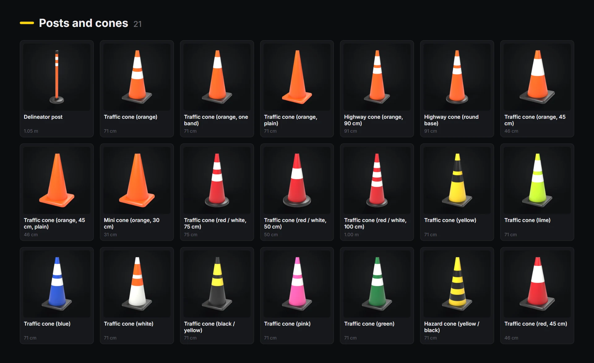</a></p>

## Tape Studio (`/tapestudio`)

Start from any style, change it and save it, for everyone on the server. Background and a second colour (gradient or split), nine patterns with their size, thickness and strength, edge bands (solid, double, dashed or checked), up to six pieces of wording with typeface, colour, every other one in a second colour, letter height, width and spacing, a box behind them, an outline, a shadow and the mark between them. The preview at the top pins, so it stays in view while you scroll.

Saved styles reach every player straight away and are kept in `data/styles.json`. Who may use it: `Config.Access.StudioJobs`, the `sd-policetape.studio` ace, and admins.

<p align="center"><a href="docs/previews/ui/studio.webp">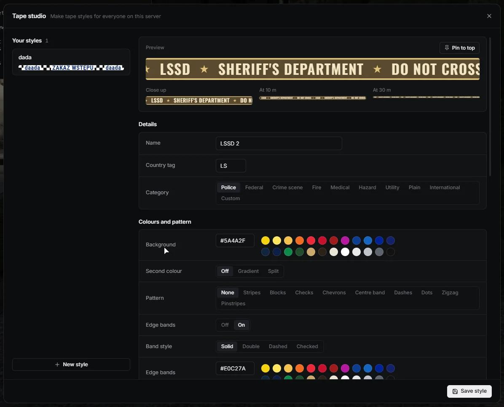</a></p>

## Admin menu (`/tapeadmin`)

Every tape on the server with who put it up, the street it is on, when, and how far away: a waypoint to it, going there, keeping it after a restart or not, and taking it down (one, every torn one, or all). Which styles and which posts and cones police may put up. Switches over the config while the server runs, kept in `data/settings.json`.

<p align="center"><a href="docs/previews/admin/tapes.webp">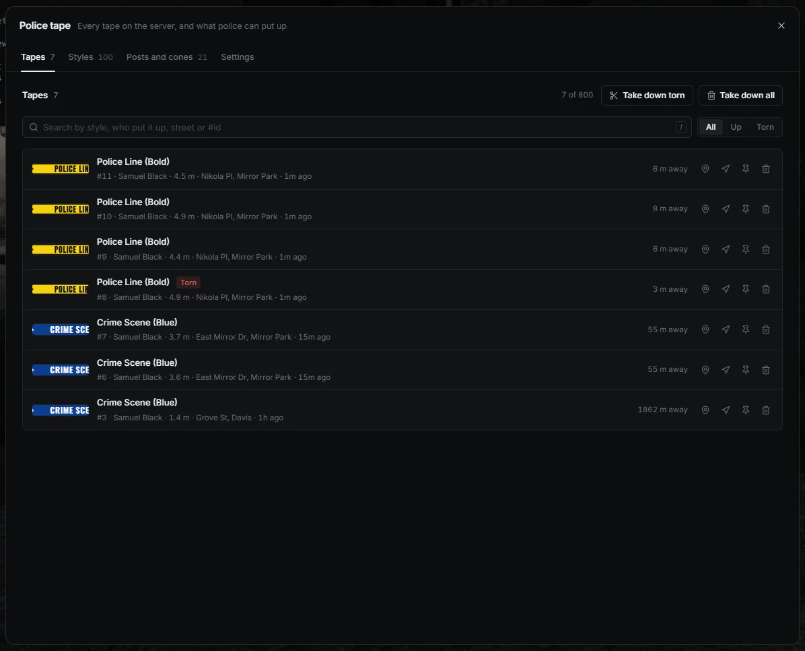</a></p>

<div align="center">
<table>
  <tr>
    <td align="center"><a href="docs/previews/admin/styles.webp">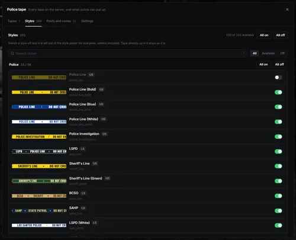</a><br /><sub>Styles</sub></td>
    <td align="center"><a href="docs/previews/admin/holders.webp">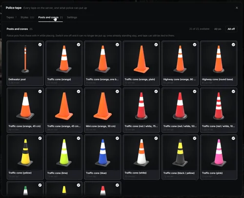</a><br /><sub>Posts and cones</sub></td>
    <td align="center"><a href="docs/previews/admin/settings.webp">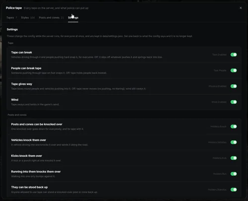</a><br /><sub>Settings</sub></td>
  </tr>
</table>
</div>

## How it behaves

| | |
|---|---|
| **Sag and wind** | Hangs by its length, sways and twists in the game's own wind, dimmed at night and indoors |
| **People and vehicles** | Bows round whoever pushes into it and slows them, wraps over a bonnet, springs back with a wobble |
| **Tearing** | A fast vehicle, a long drag or a hard push snaps it. Every tear is checked by the server, then shown to everyone. Off: it slips off and springs back into line |
| **Holders** | Cars send them along the road, kicks and runners knock them over; tape tied to one goes down with it |
| **Saving** | Tape survives a restart (`data/tapes.json`), unless whoever put it up chose otherwise with <kbd>F</kbd>, or an admin switched saving off |
| **Item** | Optional: a `police_tape` roll to tape at all. If you like, one is used up per stretch and given back when you take your own down |

## Controls

`/tape`, or use the item. Then:

| Placing | Controller | |
|---|---|---|
| Left click | RT | Start here, then tie off here |
| Mouse wheel, arrow keys | D-pad up / down | Next or previous style, live on the tape |
| <kbd>G</kbd> | D-pad left | All styles |
| <kbd>H</kbd> | D-pad right | The post and cone menu |
| <kbd>F</kbd> | Y | Kept after a restart, or not |
| Right click, <kbd>Backspace</kbd> | LT, B | Done |

Looking at tape, a prompt says **[E] Edit tape**, and <kbd>E</kbd> opens it:

| Edit tape | Controller | |
|---|---|---|
| <kbd>G</kbd> | D-pad left | Change its style |
| Hold <kbd>E</kbd> | Hold d-pad down | Take it down |
| <kbd>F</kbd> | Y | Keep it after a restart, or not |
| <kbd>Backspace</kbd> | B | Close it (so does looking away) |

A knocked-over post or cone works the same way: the prompt, then hold <kbd>E</kbd> to stand it up. The edit keys are rebindable in Settings > Key Bindings > FiveM.

| Command | |
|---|---|
| `/tape` | Start placing (or use the item) |
| `/tapestyles` | Choose the style you place with |
| `/tapestudio` | The Tape Studio |
| `/tapeadmin` | The admin menu (admins) |
| `/cleartape [metres \| all]` | Take down tape near you, or everywhere (admins) |

## Compatibility

| Layer | Supported |
|---|---|
| Frameworks | QBox, QBCore, ESX, or none (ACE permissions only) |
| Inventories | ox_inventory, qb-inventory, ps-inventory, lj-inventory, qs-inventory (and Pro), tgiann-inventory, codem-inventory, jaksam_inventory, origen_inventory, one_inventory |
| Needs | [ox_lib](https://github.com/CommunityOx/ox_lib). No database: everything is JSON in `data/` |

## Installation

Download or clone this repository into your resources (the UI is already built in `web/build`) and start it after ox_lib and your framework:

```cfg
ensure ox_lib
ensure sd-policetape
```

The roll of tape is optional (`Config.Item`). For ox_inventory, add it to `data/items.lua` and copy [`images/police_tape.png`](images/police_tape.png) into `web/images/`:

```lua
['police_tape'] = {
    label = 'Police Tape', weight = 300, stack = true, close = true,
    consume = 0, -- sd-policetape takes rolls itself when Config.Item.Consume is on
    server = { export = 'sd-policetape.usePolice_tape' },
},
```

Other inventories: register `police_tape` as a usable item the usual way; the bridge hooks it.

### Permissions

Who may tape is `Config.Access`: police, sheriff, federal, EMS, fire and DOJ jobs by default. The aces are `sd-policetape.use` (place, restyle, take down), `sd-policetape.studio` and `sd-policetape.admin` (`/cleartape`, `/tapeadmin` and anyone's tape). With txAdmin's default `add_ace group.admin command allow`, admins already have all three. Anything more specific goes in `configs/server/permissions.lua`, which gets the last word. For example, only on duty:

```lua
CanUse = function(source, default)
    local p = exports.qbx_core:GetPlayer(source)
    return default and p and p.PlayerData.job.onduty
end,
```

| File | What is in it |
|---|---|
| `configs/config.lua` | Commands, the item, access, placing, physics, wind, tearing, holders, saving, limits, keys |
| `configs/styles.lua` | The 100 built-in styles, every field explained at the top |
| `configs/holders.lua` | The post and the cones, with their sizes |
| `configs/server/permissions.lua` | Your own permission checks (server only) |

## Exports

```lua
-- server
local id = exports['sd-policetape']:PlaceTape('crime_scene', vec3(...), vec3(...), { postA = true, holderB = 'cone_orange', persist = false })
exports['sd-policetape']:RemoveTape(id)
exports['sd-policetape']:TearTape(id, 0.5)
exports['sd-policetape']:ClearTapes(coords, 25.0)   -- nil coords: everywhere
exports['sd-policetape']:GetTapes() / GetStyles()

-- client
exports['sd-policetape']:StartPlacing('police_line')
exports['sd-policetape']:IsPlacing() / GetLookedAtTape()
```

## Building from source

The UI ships built in `web/build`. To change it, with Node.js (LTS):

```bash
cd web
npm install
npm run build
```

`npm run dev` opens the pages in a browser with the 100 styles: `ui.html#picker`, `#holders`, `#studio`, `#admin`, `#place` and `#look`. `readme.html#banner`, `#hero`, `#styles-<category>` and `#holders` draw this README's pictures. The models and the cone pictures are made by `tools/` in Blender.
